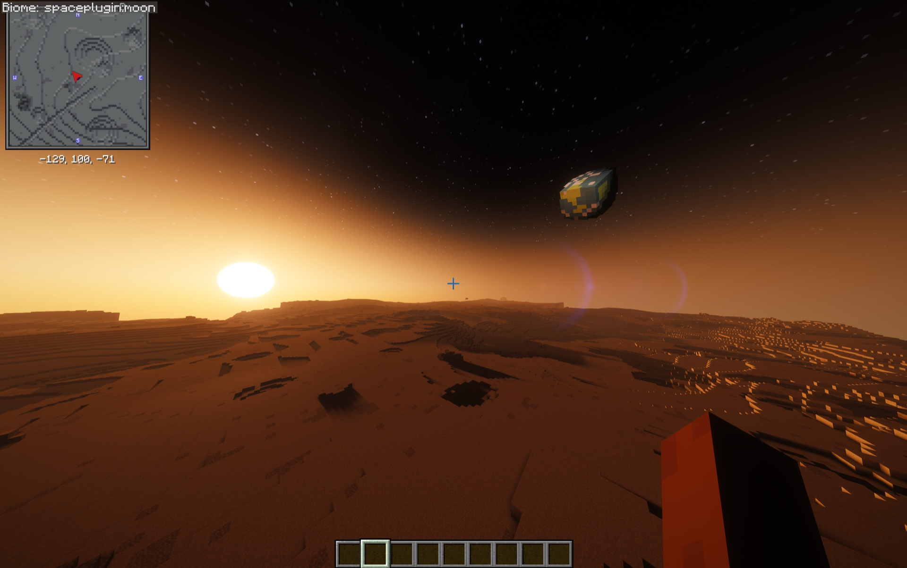
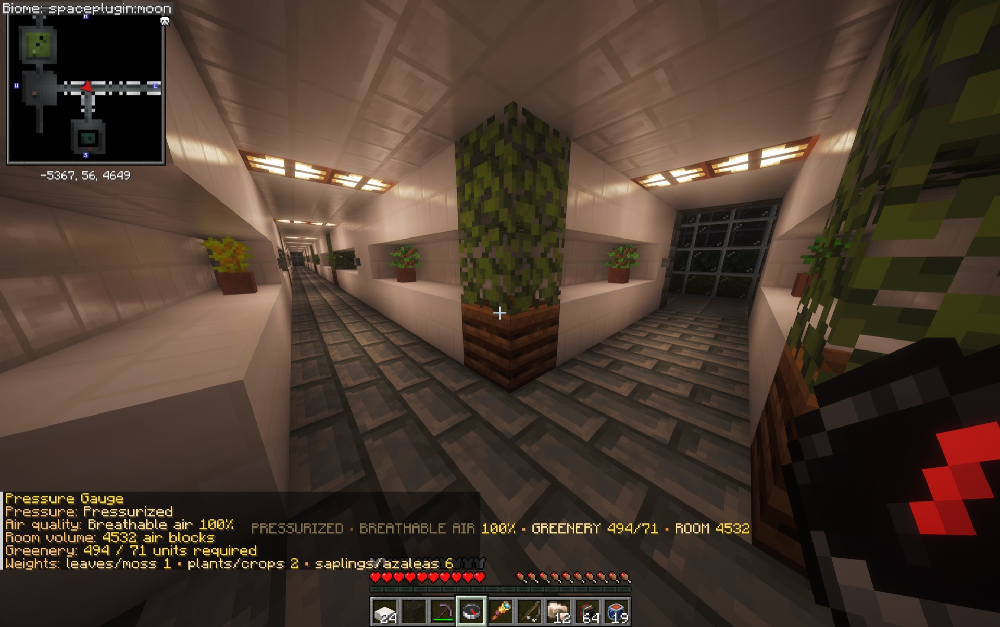
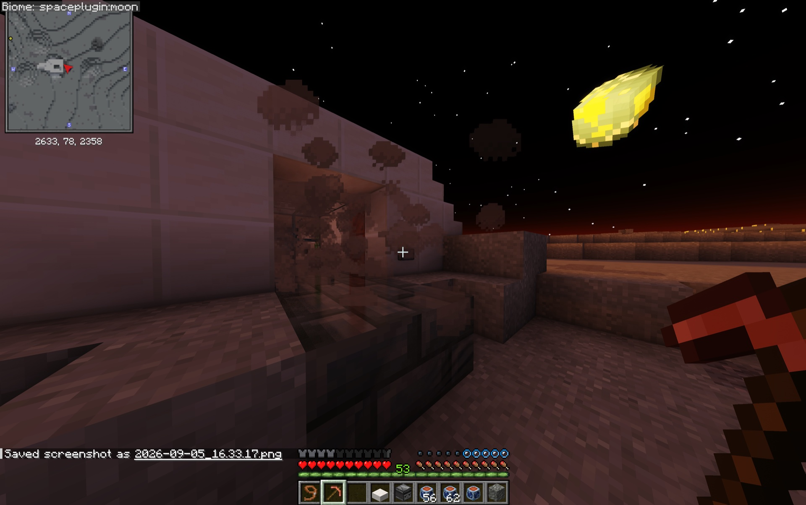

# Exploring The Moon

The Moon is the destination at the heart of the current Cosmonautics release. Artemis delivers each pilot to a persistent landing site with a habitat-equipped lander and a fueled route home.

{ .wiki-shot loading=lazy }

*Earth hangs above the Moon's generated terrain.*

## First landing

Completing an Artemis touchdown earns **One Small Step** and awards a Habitat Deployer. The lander's lower structure remains at the site while its ascent stage is reserved for the return journey.

The Moon has reduced gravity and no naturally breathable atmosphere. Keep your suit sealed and monitor oxygen whenever you leave protected air.

## Build a lunar home

Deploy a habitat, seal its structure, and establish breathable air. Continue building and use a Pressure Gauge to check your rooms before treating them as safe living space.

{ .wiki-shot loading=lazy }

*A finished lunar base uses sealed construction and greenery to maintain fully breathable air.*

## Explore beneath the surface

Generated Cosmonautics Moon worlds include catacombs with authored rooms and loot. Enter prepared: surface life support remains necessary underground, and the route back to the lander still matters.

Look for **secured colony loot rooms** inside the generated catacombs. Their special loot chests provide **Lunar Scrap**, the starting material for Lunar Alloy. Finished Alloy is made at a Station, rather than collected directly from these chests.

{ .wiki-shot loading=lazy }

*A generated catacomb entrance exposed at the lunar surface.*

!!! note "Existing chests after the beta.7 update"
    The Scrap loot applies when a chest's contents are first generated, including eligible existing chests whose contents have not yet generated. Already-generated contents are not refilled. No world reset is needed.

## Make Lunar Alloy

Start the private lesson with `/cosmo tutorial moon-workshop`, or follow the process below.

!!! important "Your first alloy needs Station access"
    A Station is optional for direct Earth–Moon travel, but required to refine Lunar Scrap. Bring a normal brewing stand, ice, glass bottles, and iron, and provide station power. The stand's vanilla recipe needs a blaze rod. Neither the stand, solar panels, nor asteroid collector requires Lunar Alloy; rovers and weapons are not prerequisites.

### 1. Produce Hydrogen

At a [powered Station brewing stand](station.md#hydrogen-and-oxygen), put **one Ice** in the top ingredient slot and **one empty glass bottle in each of the three bottom slots**. A full-power batch takes about 20 seconds and produces **two Hydrogen bottles and one Oxygen bottle**.

Run two batches to have enough Hydrogen for one Scrap. You can bring Ice from Earth or use the Station's existing Blue Ice → Packed Ice → Ice processing.

### 2. Brew Lunar Alloy Solution

Remove the gas outputs, then place:

| Slot | Ingredient |
| --- | --- |
| Top ingredient slot | 1 Lunar Scrap |
| Each of the three bottom slots | 1 Hydrogen bottle |

Place the Scrap directly into the ingredient slot; vanilla shift-clicking does not route this head item there. Keep the protected battery slot clear of fuel or other items. At full power, the stand consumes the Scrap and turns all three Hydrogen bottles into **three gray Lunar Alloy Solution bottles** in about 20 seconds.

Use Hydrogen in every bottom slot: Oxygen, water, and empty bottles cannot substitute for it. Missing ingredients or unavailable power prevent the batch from completing.

### 3. Craft finished Alloy

In your personal 2×2 crafting grid or a crafting table, place **two Lunar Alloy Solution bottles and two iron ingots in four separate cells**, in any order.

The shapeless recipe produces **one Lunar Alloy** and returns **two empty glass bottles**. Shift-click crafting also returns the bottles; any returned bottles that cannot fit in your inventory drop at your feet. Use a player crafting grid: automated Crafter blocks do not support this recipe and do not consume its ingredients.

For a complete first run, bring **1 Scrap, 2 Ice, 6 empty glass bottles, and 2 iron ingots**. After making one Alloy, you will also have **1 Solution, 1 Hydrogen, 2 Oxygen, and 2 empty bottles** left.

Finished Alloy is used by the existing rover and equipment recipes. Scrap and Solution cannot substitute for it.

!!! note "Drinking Solution"
    Lunar Alloy Solution is a crafting ingredient, but it can be drunk. It causes **Nausea I for eight seconds**, returns an empty glass bottle, and has no other special effects.

## Rovers and equipment

Use your Alloy to craft a [Solo or Duo Lunar Rover](rovers.md). Both run on Hydrogen and can be placed on Earth or the Moon. Solo seats its owner; Duo adds a passenger seat.

The Moon workshop also previews these shapeless equipment recipes:

| Result | Ingredients |
| --- | --- |
| 1 Copper Gun | 1 copper horse armor + 1 spyglass + 1 crossbow + 1 Lunar Alloy |
| 1 Rocket Launcher | 1 iron horse armor + 1 observer + 1 crossbow + 1 Lunar Alloy |
| 4 Homing Rocket Ammo | 1 Rocket Fuel + 1 Oxidizer + 1 iron ingot |

These portable weapons work away from Earth. Right-click the Copper Gun to fire one copper nugget. With the Rocket Launcher, hold right-click to acquire a target, then release after lock; each shot consumes Homing Rocket Ammo. Follow the in-game prompts and your server's combat rules.

Thruster Assembly is reserved for the unreleased interplanetary expansion and is not part of this equipment progression.

## Return to Earth

Bring Rocket Fuel to the lectern inside the lander habitat. The lectern controls the remaining ascent stage and launches it directly home. Use `/cosmo return` if you need a reminder at the landing site.

!!! note "External Moon worlds"
    A server can adopt a provider-owned Moon with a biome-only environment overlay. Its terrain and structures remain owned by that provider, so Cosmonautics catacombs are unavailable unless the provider supplies them. Such a world has no automatic source of colony Lunar Scrap unless the server owner provides suitable loot or another way to obtain it.
