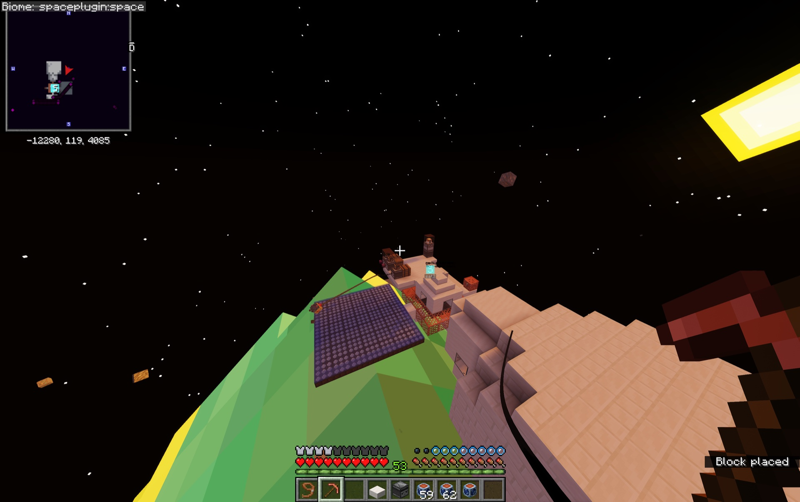

# Orbital Station

The orbital Station supports construction, processing, EVA, and cooperative play. You can travel directly between Earth and the Moon without completing Station content, but Station access is required to produce Hydrogen and refine Lunar Scrap into Alloy for rovers and equipment.

{ .wiki-shot loading=lazy }

*Station EVA with solar power, the planet display, and a visible harness tether.*

Start with the interactive lesson:

```text
/cosmo tutorial space-station
```

## Founding and arrival

A founding rocket carries the first station into orbit with its construction cargo. A station begins with a canonical shell, a docking route, and clear-sky blue solar panels. Passenger capsules approach in stages before docking with the station.

Use `/cosmo station` to open Station management, crew, and visitor controls. Released Stations remain in their supported orbit. Station voyages, including moving a Station between Earth and the Moon, and Station thrusters belong to the unreleased interplanetary expansion. Ordinary rocket travel and Station docking remain available.

## Power and processing

Station machines share the Station's solar-panel supply. Other active machines increase total demand. The tutorial demonstrates the number of panels required as each machine is introduced.

- Break suitable asteroids manually to recover materials.
- Process Blue Ice through the Electric Furnace into Packed Ice and Ice.
- Use the Electric Brewing Stand to turn Ice and empty bottles into Hydrogen and Oxygen.
- Build an Asteroid Collector Controller above its Observer to automate collection.
- Collectors extend an articulated arm, retrieve a target fragment, and eject recovered resources behind the controller.

### Hydrogen and Oxygen

Use a normal brewing stand recognized by the Station, with sufficient clear-sky blue solar panels connected to the Station's shared power supply. With default settings, **four panels fully power one brewer when no other machines are drawing power**. The battery shown in its fuel slot is a protected power display; leave the physical fuel slot empty, and do not insert or try to take a battery item.

Put **1 Ice** in the top ingredient slot and **1 empty glass bottle in each of the three bottom slots**. After about 20 seconds at full power, the batch produces **2 Hydrogen bottles + 1 Oxygen bottle**. Reduced Station power slows processing, and insufficient power pauses progress.

Hydrogen fuels [Lunar Rovers](rovers.md) and is an ingredient in [Lunar Alloy refining](moon.md#make-lunar-alloy). The same powered stand combines **1 Lunar Scrap + 3 Hydrogen bottles → 3 Lunar Alloy Solution bottles**. Put Scrap in the top slot and Hydrogen in all three bottom slots. Ordinary potion brewing remains available; follow each recipe's inputs.

## Defense machines

The guided lesson demonstrates the Station's Copper Cannon and Missile Turret after the core processing systems. Treat these as operator-controlled station equipment and follow their in-game prompts for valid use.

## Access and return

The Station Controller previews ownership and visitor access settings. When you are ready to leave, board the docked passenger capsule for the Earth-return sequence.

## EVA safety

Station space is zero gravity. Use movement input for RCS corrections and hold Shift for a forward burst. An EVA Harness can tether you to a nearby solid surface.

!!! warning "Prepare before going outside"
    Wear a complete sealed suit and carry Oxygen Canisters before entering vacuum. Use `/cosmo status` to check your equipment and oxygen state.
